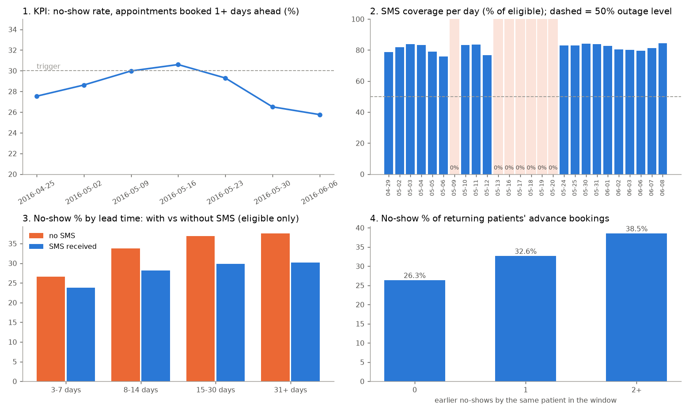

# Clinic no-shows: do SMS reminders work, and do they actually go out?

FDE Assignment: From Ambiguous Problem to Dependable Data Workflow (internship-exempted track).

The client is hypothetical: I play the FDE for the operations team of the public clinics in Vitoria, Brazil.
**The data is real and public. Nothing is synthetic.** It has 110,527 appointments (April 29 to June 8, 2016) from
the Kaggle "Medical Appointment No Shows" extract (https://www.kaggle.com/datasets/joniarroba/noshowappointments),
plus two public APIs: Brazilian holidays and daily weather.

## First time: get the data

The data is **not included** in this folder, to keep it small. The first run downloads it (about 11 MB, about
15 seconds, internet needed) and builds everything else:

```bash
cd pipeline
uv venv --python 3.12 .venv          # or: python3.12 -m venv .venv
source .venv/bin/activate
uv pip install -r requirements.txt   # or: pip install -r requirements.txt
python run_pipeline.py               # downloads the data into pipeline/data/, then runs all 4 stages
```

It should end with `===== pipeline run OK =====`. After that, the data is in `pipeline/data/raw/` and later
runs work offline. What gets downloaded:

| File | From |
|---|---|
| `data/raw/appointments_may2016.csv` | public copies of the Kaggle dataset (https://www.kaggle.com/datasets/joniarroba/noshowappointments), accepted only if sha256 = `9132d3e7...` |
| `data/raw/api/holidays_BR_2016.json` | https://date.nager.at/api/v3/PublicHolidays/2016/BR |
| `data/raw/api/weather_vitoria.json` | https://archive-api.open-meteo.com/v1/archive (Vitoria, Apr 29 to Jun 8, 2016) |

If the downloads fail (no internet, or all copies are gone), get `KaggleV2-May-2016.csv` from the Kaggle link,
save it as `pipeline/data/raw/appointments_may2016.csv` and run `python run_pipeline.py` again. The pipeline
checks the checksum and uses it.

## Where to find each part

| Submission item | File |
|---|---|
| Problem brief (2 pages) | [problem_brief.pdf](problem_brief.pdf) |
| Working notebook / repo | [pipeline/notebooks/analysis.ipynb](pipeline/notebooks/analysis.ipynb) and the [pipeline/](pipeline/) folder |
| Pipeline artifact (repeatable run with checks and logging) | [pipeline/run_pipeline.py](pipeline/run_pipeline.py); real runs in [pipeline/outputs/pipeline_run_log.txt](pipeline/outputs/pipeline_run_log.txt); check results in [pipeline/outputs/run_checks.csv](pipeline/outputs/run_checks.csv) |
| Demo video | https://www.loom.com/share/54ed45edf2b348ea987dac63c069a418 |

| Skill area | Evidence |
|---|---|
| 1. FDE mindset and stakeholders | [pipeline/docs/stakeholders_and_scope.md](pipeline/docs/stakeholders_and_scope.md), section 1 below |
| 2. Workflow and problem structure | [pipeline/docs/workflow_and_data_model.md](pipeline/docs/workflow_and_data_model.md), section 2 below |
| 3. KPIs, scope and solution | [pipeline/docs/metric_definitions.md](pipeline/docs/metric_definitions.md), [pipeline/docs/stakeholders_and_scope.md](pipeline/docs/stakeholders_and_scope.md) |
| 4. Client data and source systems | [pipeline/docs/source_map.md](pipeline/docs/source_map.md) |
| 5. Retrieval (CSV file + 2 JSON APIs) | [pipeline/scripts/stage1_retrieve.py](pipeline/scripts/stage1_retrieve.py), [pipeline/outputs/raw_manifest.json](pipeline/outputs/raw_manifest.json) |
| 6. Profiling and cleaning | notebook section 2, [pipeline/scripts/rules.py](pipeline/scripts/rules.py), [pipeline/scripts/stage2_validate.py](pipeline/scripts/stage2_validate.py), [pipeline/docs/validation_rules.md](pipeline/docs/validation_rules.md) |
| 7. Workflow model with data | [pipeline/scripts/stage3_model.py](pipeline/scripts/stage3_model.py) (SQLite model), [pipeline/scripts/stage4_metrics.py](pipeline/scripts/stage4_metrics.py) (SQL joins and aggregations) |
| 8. Dependable pipeline | [pipeline/run_pipeline.py](pipeline/run_pipeline.py), [pipeline/outputs/pipeline_run_log.txt](pipeline/outputs/pipeline_run_log.txt), [pipeline/tests/test_rules.py](pipeline/tests/test_rules.py) |
| Results | [pipeline/outputs/evidence_table.md](pipeline/outputs/evidence_table.md), [pipeline/outputs/dashboard.png](pipeline/outputs/dashboard.png) |

## 1. FDE mindset and stakeholders

Owner: the clinic operations manager. Also affected: reception staff, doctors, patients, the SMS vendor and the
health secretariat that funds the clinics. Goals, constraints, facts, assumptions and unknowns for each:
[pipeline/docs/stakeholders_and_scope.md](pipeline/docs/stakeholders_and_scope.md).

## 2. Workflow and problem

book -> slot saved -> SMS reminder (only if booked 3+ days ahead) -> appointment day -> attended / no-show -> rebook.
Full map and where the problem appears: [pipeline/docs/workflow_and_data_model.md](pipeline/docs/workflow_and_data_model.md).

**Problem statement.** About 3,500 advance-booked appointments a week end in a no-show (28.5%). The clinic
believes the SMS reminder doesn't work, because patients who got an SMS no-show more often (27.6% vs 16.7%). It
needs to know whether reminders reduce no-shows, and whether the reminder process is reliable, before it
drops, keeps or extends them.

## 3. KPI, scope and success

**Project KPI: no-show rate of appointments booked 1+ days ahead** (28.52% pooled). Same-day bookings are left out:
they are 35% of rows, mostly walk-ins, and only 4.65% no-show.

| # | Supporting metric | Pooled |
|---|---|---|
| S1 | Reminder coverage of eligible appointments (booked 3+ days ahead) | 59.12% (81.69% on normal days) |
| S2 | Reminder effect at the same lead time | 5.4 points fewer no-shows (outage-day check: 4.3) |
| S3 | Share of no-shows from patients with 2+ no-shows | 35.3%, from 5.17% of patients |
| S4 | Advance bookings made 15+ days ahead | 38.56% |

MVP: a weekly pipeline that answers "do reminders work", "did they all go out" and "who should reception call".
Out of scope: prediction models, overbooking, SMS wording, cost figures. Success: a 4-week test lowers the KPI by
2+ points vs control, with coverage above 80% every day. Details and guardrails: [pipeline/docs/stakeholders_and_scope.md](pipeline/docs/stakeholders_and_scope.md).
Formulas and triggers: [pipeline/docs/metric_definitions.md](pipeline/docs/metric_definitions.md).

## 4. Client data and source systems

| Source | Stands in for | Grain | Retrieval mode |
|---|---|---|---|
| Appointment extract CSV (Kaggle, via 3 byte-identical GitHub copies) | the clinics' scheduling system | one row per appointment | CSV file over HTTPS, pinned sha256 |
| Nager.Date public holidays API | the official calendar | one row per holiday | JSON API |
| Open-Meteo historical weather API | external context | one value per day | JSON API |

Source of truth, key fields and missing data/events (SMS send time, delivery status, phone on file,
cancellations, clinic/doctor id): [pipeline/docs/source_map.md](pipeline/docs/source_map.md).

## 5. Retrieval

`pipeline/scripts/stage1_retrieve.py`:

- Kaggle needs a login, so the pipeline tries 3 public copies in order and **only accepts one whose sha256
  matches the pinned value**. The URL can change; the checksum can't. The row count must be 110,527.
- Files are written to `.part` first and renamed when complete. Raw files are never edited.
- API responses are saved exactly as received, with a sha256 in `pipeline/data/raw/manifest.json`. The data
  itself is not shared (it is downloaded on the first run), but the pinned checksum means every download is
  byte-for-byte the same file. A copy of the manifest without timestamps is
  [pipeline/outputs/raw_manifest.json](pipeline/outputs/raw_manifest.json).
- The weather request is built from the first and last appointment dates in the file, so it always covers the extract.

## 6. Profiling and cleaning

Profiling: notebook section 2. 12 rules (5 FAIL, 3 WARN, 4 INFO) with counts, reasons and actions:
[pipeline/docs/validation_rules.md](pipeline/docs/validation_rules.md). Only 6 rows are excluded (0.005%): 5 appointments dated
before their booking, and 1 negative age. Nothing is deleted.

Safe fixes (on a copy, never on the raw file): patient ids read as text so each id stays exactly as written, `No-show` mapped
once to `no_show = 1/0`, dates parsed to calendar days.

What I did not silently fix: the UTC label on booking times (they are local time, recorded as an assumption);
5 corrupted patient ids (kept, left out of repeat-patient metrics); Handcap values 0-4 (a count, not a flag).

## 7. Workflow model with data

`pipeline/scripts/stage3_model.py` builds SQLite: `fact_appointment` joined to `dim_patient`, `dim_date` (holiday, rain,
reminder coverage per day) and `dim_neighbourhood`, plus `appointment_flag`, `validation_rule`, `run_check` and
the view `appointment_event` (booked -> reminder_sms -> attended / no_show). `pipeline/scripts/stage4_metrics.py` computes
the metrics with joins, `GROUP BY` and a window function for each patient's earlier no-shows.

## 8. Dependable pipeline

`python run_pipeline.py` runs retrieve -> validate -> model -> metrics. Five real runs, including failures, are in
[pipeline/outputs/pipeline_run_log.txt](pipeline/outputs/pipeline_run_log.txt).

- Logging: every stage logs to the console and to `pipeline/logs/pipeline.log`, with counts and check results.
- Checks between stages: checksum, row count, raw = valid + excluded, 100% of rows join, FAIL share under 2%,
  every empty weekday is a holiday, no day with reminder coverage under 50%.
- Rerun: if the file matches the checksum it isn't downloaded again, and cached API responses are reused
  (`--refresh-api` to re-fetch). Stage 4 logs whether `weekly_metrics.csv` changed.
- Failures: 3 attempts with 2 s and 4 s waits. A 404 or bad checksum moves to the next copy. If no copy matches,
  the run stops with exit 1 and the old file is kept. A corrupted local file is downloaded again. If an API is
  down, the cached copy is used; if there is none, that check is skipped with a WARN. If FAIL rows go over the
  limit, the run is HELD: metrics are blank and the exit code is 2. The database is built in a `.part` file and
  swapped in only when complete.

## Setup and run

Python 3.12 and internet access for the first run (about 11 MB, about 15 seconds).

```bash
cd pipeline
uv venv --python 3.12 .venv          # or: python3.12 -m venv .venv
source .venv/bin/activate
uv pip install -r requirements.txt   # or: pip install -r requirements.txt

python run_pipeline.py                           # full pipeline, writes outputs/
python run_pipeline.py                           # rerun: download skipped, metrics identical
python run_pipeline.py --max-fail-share 0.00001  # forces a HELD run (exit code 2)
python -m pytest -q tests                        # 18 tests

cd notebooks
jupyter nbconvert --to notebook --execute --inplace analysis.ipynb
```

Exit codes: 0 = published, 1 = a stage failed, 2 = run held.

```
problem_brief.pdf              the problem brief (2 pages)
pipeline/
  run_pipeline.py              runs the 4 stages in order
  scripts/
    stage1_retrieve.py         download the CSV + 2 APIs, checksum and row-count checks
    stage2_validate.py         12 validation rules, flag rows (never delete)
    stage3_model.py            SQLite model + between-stage checks
    stage4_metrics.py          KPI + 4 metrics in SQL, evidence table, dashboard
    rules.py, common.py        rule catalogue, shared settings
  notebooks/analysis.ipynb     working notebook (reads the pipeline's outputs)
  docs/                        stakeholders_and_scope, workflow_and_data_model, source_map,
                               validation_rules, metric_definitions
  outputs/                     evidence_table.md, weekly_metrics.csv, dashboard.png,
                               run_checks.csv, pipeline_run_log.txt, ...
  tests/test_rules.py          18 unit tests
  brief/problem_brief.html     source of problem_brief.pdf
  data/, logs/                 created by the first run (not shared, see "First time: get the data")
```

## Results

Full tables: [pipeline/outputs/evidence_table.md](pipeline/outputs/evidence_table.md).



What I found:

1. **Reminders seem to help, even though the naive number says the opposite.** With an SMS: 27.6% no-show; without: 16.7%. But
   SMS is only sent 3+ days ahead, and no-shows rise with lead time (4.7% same day, 33% at 31+ days). At the
   same lead time, SMS patients no-show 2.8 to 7.3 points less (5.4 weighted).
2. **Reminders didn't go out on 7 appointment days** (May 9, 13, 16-20): 0% coverage vs 76-85% on other days.
   The week of May 16 had the highest KPI (30.6%). The outage also works as a fair test: same lead time, outage
   days no-show 4.3 points more.
3. **Repeat no-shows are concentrated:** 5% of patients cause 35% of no-shows. A patient with 2+ earlier no-shows
   misses 38.5% of advance bookings. The call list is about 3 calls per neighbourhood per day.
4. **Rain: can't tell.** 18.9% no-show on rainy days vs 20.3% on dry days, but there were only 2 rainy days, so this is weak evidence.

What I would tell the operations manager:

1. Don't drop the SMS. Add a daily alert when coverage on a day is under 50%. Filling the gaps alone is worth
   about 1.8 KPI points (about 1,325 fewer no-shows over these 6 weeks).
2. Ask the SMS vendor what happened May 9-20, and ask the clinics why May 23 and May 27 have no appointments.
3. Test extending SMS to 1-2 day bookings (22.7% no-show, no reminder today), plus a reception call from the
   call list. 4 weeks, with a control group.

## The judgement call

The obvious conclusion from the data is "SMS reminders don't work, stop paying for them". I didn't accept it,
because the reminder isn't given at random. It depends on lead time, and lead time drives no-shows. So I compared
inside lead-time bands. Then I used the outage days as a second check, because on those days nobody could have
been picked for an SMS. Both point the same way: reminders are linked to about 4-5 points fewer no-shows. It is
still not a randomised test, which is why the next step is a controlled 4-week trial.

## Known / Unknown / Assumption / Limitation

**Known:**
- 110,527 appointments, 110,521 valid; KPI 28.52%; all no-shows 20.19%.
- SMS is never received when booked under 3 days ahead (0 of 50,501 rows).
- 7 appointment days had 0% reminder coverage.
- May 23 and May 27 have no appointments and aren't national holidays; May 26 is Corpus Christi.

**Unknown:**
- Why the SMS job sent nothing on the 7 days (vendor outage or export gap).
- Whether "SMS_received" means sent or delivered, and when it was sent.
- Why about 18% of eligible patients get no SMS on normal days (no phone on file?).
- Whether a cancelled appointment is recorded as a no-show.

**Assumptions:**
- `ScheduledDay` is local time, even though it is marked UTC.
- `Neighbourhood` is where the appointment is (Kaggle description).
- Same-day bookings are mostly walk-ins and belong outside the KPI.
- Trigger levels are my own, set from these 6 weeks.

**Limitations:**
- 6 weeks of data from 2016; no seasonality, and the window starts with no patient history, so repeat
  no-shows are undercounted in the early weeks.
- The outage-day check is not a randomised test; something else could have changed that week.
- No clinic, doctor or time-of-day fields.
- Only national holidays are checked; a state or city holiday could explain May 23 or 27.
