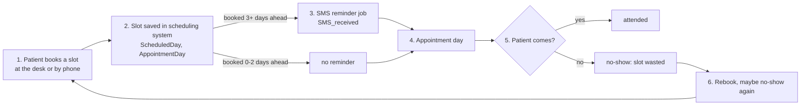
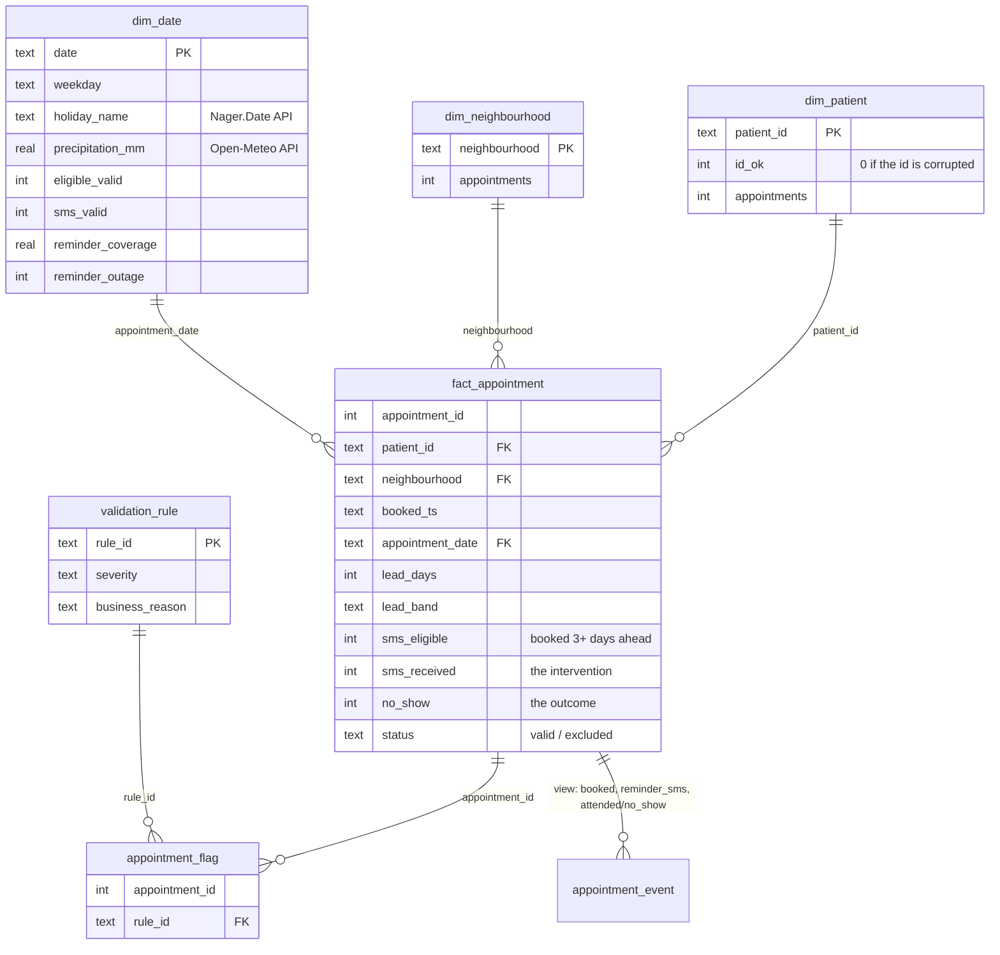

# Workflow and data model

## The current workflow

One appointment goes through these steps. The problem shows up at step 5, but the cause can be at step 1
(how far ahead the slot is booked) or step 3 (whether a reminder actually went out).



Plain-text version:

```
book (desk / phone)              <- lead time is decided here
  -> slot in scheduling system
  -> SMS reminder, only if booked 3+ days ahead   <- the intervention; failed on 7 days
  -> appointment day
  -> attended | no-show          <- the outcome (the KPI)
  -> rebook                      <- repeat no-shows come back here
```

Where the problem appears and what happens around it:

| Before | The problem | After |
|---|---|---|
| booking lead time (median 4 days, 38.6% of advance bookings 15+ days out); reminder sent or not | the patient doesn't come; 28.5% of advance-booked slots | slot is lost, doctor idle; patient rebooks later; 5% of patients cause 35% of no-shows |

## Entities, events, intervention, outcome

- Entities: patient, appointment (slot), neighbourhood (where the clinic is), calendar day.
- Events: booked (timestamp), reminder_sms (no timestamp in the source), attended or no_show (appointment date).
- Intervention: the SMS reminder. A second intervention is proposed: a reception phone call from the call list.
- Outcome: `no_show` per appointment, rolled up into the weekly KPI.
- Day-level context: public holiday (API), rain (API), reminder coverage and outage flag (computed).

## The relational model (SQLite, `data/processed/clinic.db`)



Plain-text version:

```
dim_patient (1) ---< fact_appointment >--- (1) dim_date   [holiday + rain + reminder coverage per day]
                        |       \
                        |        >--- (1) dim_neighbourhood
                        +---< appointment_flag >--- validation_rule
fact_appointment (1) ---< appointment_event (view, 2 or 3 events per appointment)
run_check: file-level and day-level checks
```

Notes on the choices:

- The grain is the appointment (one slot). A patient with 3 slots on one day counts 3 times, because 3 slots
  were wasted. In 82% of those cases all slots share the same outcome.
- `fact_appointment` keeps the 6 excluded rows, so `raw = valid + excluded` can be checked in SQL.
- `reminder_outage` is on `dim_date`, not on the appointment, because the outage is a property of the day: it
  doesn't depend on the patient. That is what makes it usable as a fair comparison.
- Repeat no-shows use a window function over earlier days only (`RANGE ... 1 PRECEDING`), so a second slot on
  the same day doesn't count as history.
